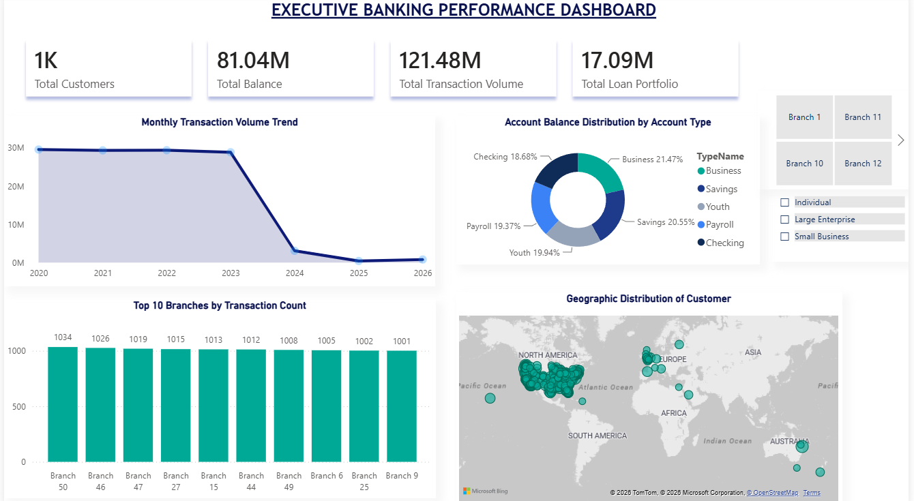
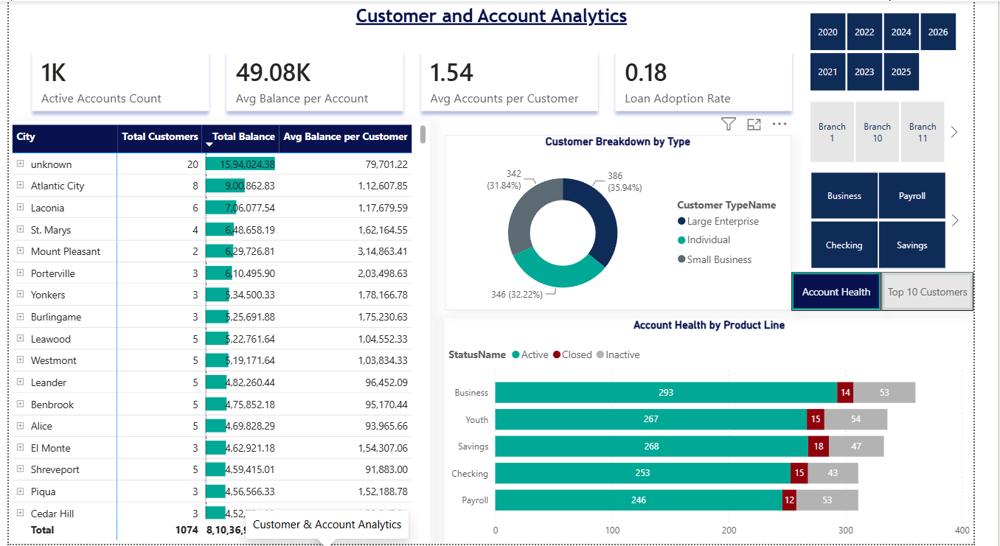

🏦 Bank Analytics & Risk Performance Dashboard

📌 Project Overview

This project delivers an interactive, multi-page Power BI Analytics Solution designed for retail and commercial banking executives. The dashboard provides end-to-end visibility across financial performance, customer demographics, branch operations, and credit risk exposure.

By converting raw relational banking data into dynamic visualizations, this tool equips management with real-time insights into deposit liquidity, loan default rates, branch-level transaction anomalies, and customer segment profitability.

🛠️ Technology Stack & Methods

 Business Intelligence: Microsoft Power BI Desktop

 Data Modeling & Analytics: DAX (Data Analysis Expressions) for dynamic aggregations, time-intelligence, and risk KPIs

 Data Visualizations: Custom-styled Clustered Bar Charts, Heatmap Matrices, Gauge Charts, Donut Charts, and High-Value Audit Tables

 Design & UX Framework: Executive Dark Navy (⁠#0F2C59⁠) & Light Teal (⁠#E0F2F1⁠) theme with structured visual card containers (⁠8px⁠ rounded borders) and custom column auto-sizing

📊 Dashboard Architecture & Key Pages

1. Executive Overview

 Focus: High-level institutional growth and overall financial performance.

 Key Metrics: Total Deposits, Net Cash Flow, Total Customers, and Account Growth.

2. Customer & Account Analytics

 Focus: Demographic breakdown and segment behavior.

 Key Metrics: Account balance distributions across Individual, Small Business, and Large Enterprise tiers.

3. Transactions & Branch Analysis

 Focus: Branch-level operational performance and risk auditing.

 Visual Highlights:

 Interactive Slicers: Dynamic Year/Date Range slider and Branch/City multi-select dropdowns with integrated search.

 Branch Performance Heatmap: Matrix grid evaluating transaction volume across cities and customer types.

 High Transaction Flagged Table: Automated auditing view highlighting high-risk withdrawal and transfer activities for regulatory compliance.

4. Loan Portfolio & Risk Performance

 Focus: Credit exposure and loan default monitoring.

 Visual Highlights:

 Top KPI Cards: Total Outstanding Loans ($17.09M) and Delinquent / Overdue Loans ($1.67M).

 Loan Status Donut Chart: Risk categorization across Active, Paid Off, and Defaulted loan statuses.

 Average Interest Rate Gauge Chart: Real-time interest rate tracking benchmarked against a static target threshold.

 Segment Clustered Column Chart: Direct comparison of total loan portfolio value against average account balances by customer type.

📈 Key Insights & Business Findings

 Strong Liquidity Position: Managed total deposits of $36.92M against $35.97M in withdrawals, indicating healthy liquidity retention across active accounts.

 Controlled Delinquency Rate: Delinquent/overdue exposure is maintained at $1.67M out of a total $17.09M portfolio (~9.7%), providing clear target segments for credit recovery teams.

 Audit Transparency: Flagged high-value transaction tables allow risk compliance teams to quickly isolate large individual withdrawals (e.g., $4,125.32 at Branch 44) for immediate fraud verification.

 📸 Dashboard Preview of Executive Banking Performance

 📸 Dashboard Preview of Customer & Account Analytics

 📸 Dashboard Preview

 📸 Dashboard Preview

 📸 Dashboard Preview

